# Minha Cozinha | Modelagem da solução

**Versão 0.2 · Fluxo inicial do MVP · 16 de novembro de 2026**

Base: [03 · PRD do MVP](03-prd.md)

## Legenda

- **Roxo:** etapas em que a IA atua (extração e normalização de ingredientes).
- **Vermelho:** regras de segurança alimentar (perfil, bloqueio de conflitos, revalidação de trocas).
- **Cinza tracejado:** P1, fora do recorte P0 do MVP.

## Fluxo

```mermaid
flowchart LR
  A(["Abre o link da PWA"]) --> B{"Já tem conta?"}
  B -->|"Não"| C["Home: O que você tem em casa?"]
  B -->|"Sim"| R["Home de retorno: despensa, histórico e sobra em destaque"]
  R -->|"Nova sugestão"| C
  R -->|"Ver histórico"| H["Histórico: Quero fazer, Planejado, Feito, Faria de novo"]
  H -->|"Abre receita salva"| F
  C --> D{"Canal de entrada"}
  D -->|"Foto"| P{"Permissão concedida?"}
  D -->|"Voz"| P
  D -->|"Texto avulso"| L
  D -.->|"NFC-e (P1)"| N["Leitura do QR do cupom"]
  P -->|"Não"| D
  P -->|"Sim"| E["IA extrai candidatos a ingredientes"]
  N -.-> E
  E --> X{"Extração ok?"}
  X -->|"Falha ou ambígua"| XF["Mantém estoque anterior e oferece outro canal"]
  XF --> D
  X -->|"Sim"| L["Revisar lista: aceitar, renomear, remover, adicionar"]
  L --> S["Despensa aproximada: Pouco, Suficiente, Confirmar"]
  S -.->|"P1"| VAL["Validade opcional informada pela pessoa; vencidos ficam fora"]
  VAL -.-> Q
  S --> Q{"Restrições já declaradas?"}
  Q -->|"Não"| PR["Perfil: preferência, intolerância e alergia. Aviso: condição clínica fora do MVP"]
  Q -->|"Sim"| T
  PR --> T["Condições de hoje: tempo (40 min), porções, Sem compras"]
  T --> M1["Busca em sites especializados"]
  M1 --> M2{"Busca retornou?"}
  M2 -->|"Falhou"| M3["Catálogo de reserva"]
  M2 -->|"Sim"| M4["IA extrai e normaliza ingredientes"]
  M3 --> M5
  M4 --> M5["Regras críticas determinísticas: bloqueio de conflitos"]
  M5 --> M6["Filtra disponibilidade e tempo; ordena por faltantes e esforço"]
  M6 -.->|"P1"| PRI["Prioriza itens perto de vencer e sobras confirmadas"]
  PRI -.-> O
  M6 --> O{"Há opções elegíveis?"}
  O -->|"Não"| O2["Sem opções verificáveis: confirmar item, aumentar tempo ou ver com compras"]
  O2 --> T
  O -->|"Sim"| O3["Até 3 opções com tempo, esforço, motivo e crédito da fonte"]
  O3 --> F["Ficha da receita: disponíveis x pendentes, passo a passo, trocas validadas"]
  F -->|"Pede troca ou muda porção"| V{"Continua elegível?"}
  V -->|"Sim"| F
  V -->|"Não"| V2["Explica e volta à última versão válida"]
  V2 --> F
  F -.->|"P1"| CV["Conversa na receita: dúvidas de etapa e troca"]
  CV -.->|"Pergunta clínica"| CV2["Recusa e orienta revisar perfil ou buscar profissional"]
  CV -.->|"Altera ingrediente"| V
  F -->|"Salvar ou cozinhar"| G{"Logado?"}
  G -->|"Não"| G2["Login Google ou Apple, preservando os dados"]
  G2 --> SV
  G -->|"Sim"| SV{"O que fazer com a receita?"}
  SV -->|"Quero fazer ou Planejado"| H
  SV -->|"Cozinhei"| FT["Marca Feito"]
  FT -.->|"P1"| RV{"Revisa usados e sobras?"}
  RV -.->|"Pular"| RV1["Itens afetados voltam para Confirmar"]
  RV -.->|"Sim"| RV2["Atualiza despensa e guarda a sobra para a próxima busca"]
  RV1 -.-> FN
  RV2 -.-> FN
  FT --> FN["Marcador opcional: Faria de novo"]
  FN --> H
  classDef ia fill:#EDE7FB,stroke:#7C5CD6
  classDef regra fill:#FDECEC,stroke:#D64545
  classDef p1 fill:#F2F2F2,stroke:#999999,stroke-dasharray:4
  class E,M4 ia
  class M5,V,PR regra
  class N,VAL,PRI,CV,CV2,RV,RV1,RV2 p1
```

## Decisões desta versão

| # | Decisão | Motivo |
|---|---|---|
| 1 | Restrições perguntadas depois da despensa e antes das condições de hoje. | O PRD exige só que venham antes da primeira receita. Perguntar no início cobra esforço antes de mostrar valor. |
| 2 | Login pedido ao salvar ou cozinhar, depois da primeira sugestão. | Segue a decisão 6 do PRD. Os dados informados antes são preservados na conta. |
| 3 | Revisão de usados e sobras após o "Feito" marcada como P1. | Faz parte do R08 (Aproveitamento), que é P1 no PRD. No P0, "Feito" segue direto para o histórico. |
| 4 | Conversa na receita (R12) e prioridade por validade (R08) incluídas como ramos P1. | Mostrar a visão completa sem misturar com o escopo do MVP. |

## Histórico de versões

- **v0.1:** primeiro fluxo do caminho P0.
- **v0.2:** inclusão dos ramos P1 (R08 e R12) e revisão de sobras reclassificada como P1.
